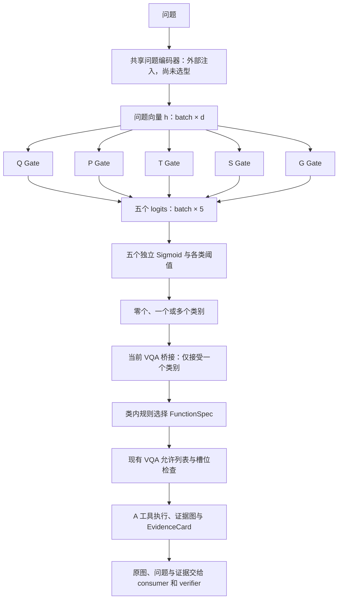

# 五类 Gate 网络调研与实现

更新：2026-11-02。范围：Q/P/T/S/G 五个独立小 Gate 的网络、选择策略和现有 VQA 适配。网络与可选接入接口已实现；编码器、训练目标、训练集和校准协议尚未决定。

## 1. 调研结论

Gate 输入已有编码器产生的问题向量；编码器和 Gate 是两个模块，编码器的具体选择由后续训练方案决定。

| 结构 | 文献或用途 | 对本项目的意义 |
|---|---|---|
| 线性投影 + Softmax + top-k | [Switch Transformers，JMLR 2022，§2.1](https://jmlr.org/papers/volume23/21-0998/21-0998.pdf) 的路由 logits 为 `W_r x`，Switch 使用 top-1 | 线性 Gate 是应该保留的简单对照；其跨专家归一化和 token 路由不直接等于本项目的能力选择 |
| 每个任务一个小 Gate | [MMoE，KDD 2018，作者页面](https://research.google/pubs/modeling-task-relationships-in-multi-task-learning-with-multi-gate-mixture-of-experts/) 为不同任务设置 Gate，共享专家子模型 | 可借鉴独立 Gate 的设计；原 MMoE 的每个 Gate 混合多个共享专家，和这里每类一个二元启用 Gate 的拓扑不同 |
| 独立 Sigmoid | [Nguyen 等，NeurIPS 2024](https://arxiv.org/abs/2405.13997) 研究 Sigmoid 与 Softmax 门控的专家估计 | 支持把 Sigmoid 作为选择之一；论文的回归理论结论不能当成本项目路由准确性的证据 |
| 小型二层 MLP + 独立 Sigmoid | 本次工程默认，保留线性模式对照 | 加入少量非线性，允许一问启用多类能力；是否优于线性必须实测 |

本次采用 **五个参数独立的 MLP，每个输出一个 logit，再分别做 Sigmoid**。默认隐藏宽度 128；`architecture="linear"` 可切换为单层线性 Gate。隐藏宽度和 0.5 阈值都是配置初值，没有经过医学或路由数据校准。

## 2. 网络与应用架构



单个 MLP Gate：`Linear(d, 128) → GELU → Dropout(0) → Linear(128, 1)`。五个 Gate 不共享头部参数，只共享输入向量。`d=768` 时五个 MLP 共 **492,805** 个参数；五个线性 Gate 共 **3,845** 个参数，均不含编码器。

类别顺序固定为 `Q, P, T, S, G`。这里选择五类能力，26 项功能仍属于原来的类别目录：Q 类 4 项、P 类 12 项、T 类 4 项、S 类 3 项、G 类 3 项。Gate 不直接选择 A 工具，工具依赖仍由类内选中的 FunctionSpec 决定。

本版网络接收问题向量，不读取胸片或参考答案；图文联合路由需要另行定义编码器和检查点。

## 3. 已实现接口

| 文件 | 职责 |
|---|---|
| `src/visevi/vqa/gate_network.py` | `GateNetworkConfig`、`FiveCategoryGates`、`NeuralCategoryGate` |
| `src/visevi/vqa/category_gate.py` | 与 PyTorch 无关的类别协议、独立阈值策略、路由记录 |
| `src/visevi/vqa/category_function_gate.py` | 把类别结果适配为现有 `FunctionGate`，类内采用规则基线 |
| `src/visevi/vqa/schema.py` | 在 `RouteDecision` 的可选 `category_route` 字段保留类别结果 |
| `src/visevi/vqa/runner.py` | 功能未开放或槽位非法时保留类别记录 |
| `tests/test_category_gate.py` | CPU 合成网络、梯度、选择策略、隔离及 VQA 注入测试 |

`FiveCategoryGates.forward(features)` 返回 `[batch, 5]` logits；`activation_scores(features)` 返回相同形状的 Sigmoid 分数。两个接口均保留梯度，不绑定标注路由 loss 或最终回答 loss。

`NeuralCategoryGate` 是部署接口，接收 `encode_questions(list[str]) -> Tensor[batch, d]`。默认 `ready=False`：直接返回 `untrained`，不调用编码器，也不使用随机初始化分数调用功能。加载合适的 Gate/编码器权重后，由调用方显式设置 `ready=True`，并把网络与编码器设为 `eval()`。`model_id` 应标识 Gate 权重和编码器版本；`ready` 是调用方的就绪声明，不是自动准确性验证。

部署结果保留五个 logits、五个激活分数、所选类别、各类阈值、类别预算、版本和拒绝原因。分数始终标记 `score_calibrated=false`，不解释为疾病概率或证据可信度，也不拿来加权合并工具 Claim。日志不记录问题向量。

选择策略允许多选、允许全不选，不强制 argmax。若配置 `max_categories` 且超限，则明确返回 `ambiguous`，不截掉其余类别。类别预算缺省不限制；现有单功能 VQA 桥接器遇到多个类别会拒绝执行，并在记录中保留原始多选结果。

## 4. 使用方法

环境已具备 PyTorch 时，可运行下面的 CPU 合成示例：

```python
import torch
from visevi.vqa.gate_network import (
    FiveCategoryGates, GateNetworkConfig, NeuralCategoryGate,
)

network = FiveCategoryGates(GateNetworkConfig(input_dim=768, hidden_dim=128))
features = torch.zeros(2, 768)  # 仅检查形状；真实使用需要问题编码器
logits = network(features)     # [2, 5]，保留梯度

gate = NeuralCategoryGate(
    network,
    encode_questions=lambda questions: torch.zeros(len(questions), 768),
    model_id="untrained-demo",
)
assert gate.route_categories("这张胸片是 PA 还是 AP？").status == "untrained"
```

网络配置用 `network.config.to_dict()` 记录；权重采用标准 `state_dict()`。项目额外声明可选依赖组 `routing`，基础 `visevi.vqa` 导入不会自动导入 PyTorch。

配置好**实际编码器及匹配的已训练权重**后，通过现有注入点接入：

```python
from visevi.vqa import CategoryFunctionGate, VQARequest, run_vqa_episode
from visevi.vqa.gate_network import NeuralCategoryGate

# network 和 encode_questions 由调用方提供；先加载配套权重。
network.eval()
# 若 encode_questions 本身是 nn.Module，也须先 encode_questions.eval()。
category_gate = NeuralCategoryGate(
    network, encode_questions,
    model_id="gate-checkpoint-and-encoder-version", ready=True,
)
function_gate = CategoryFunctionGate(category_gate)
result = run_vqa_episode(
    VQARequest(image_ref="/path/to/local-image.jpg", question="PA 还是 AP？"),
    gate=function_gate, consumer=consumer, registry=registry,
)
```

这是 Python API 接入示例，不会自动更改默认路由。当前没有已训练 Gate 权重，原有 `RuleFunctionGate` 保持默认；VQA runner 可执行 26 项中的唯一选中功能。类别多选仍由单功能桥接器拒绝，并保留原始类别记录。

## 5. 训练状态

训练尚未开始。后续需要确定问题编码器、路由监督目标、训练/校准/测试划分和阈值；部署时仍由 FunctionSpec 与工具协议约束可执行功能。

## 6. 本次验证

新增测试覆盖五头参数独立、固定类别顺序、线性/MLP 两种模式、编码器与 Gate 梯度连续、`state_dict` 往返、非法输入、独立阈值、多选/全不选、超预算拒绝、未训练拒绝、类内候选隔离，以及 Q4/P9 执行与非法槽位时的类别记录保留。所有网络检查使用 CPU 合成张量；VQA 检查使用合成工具和 consumer。

只运行本次 Gate 与原 VQA 测试：

```bash
PYTHONDONTWRITEBYTECODE=1 PYTEST_DISABLE_PLUGIN_AUTOLOAD=1 \
HF_HUB_OFFLINE=1 TRANSFORMERS_OFFLINE=1 CUDA_VISIBLE_DEVICES='' MPLBACKEND=Agg \
.venv/bin/python -B -m pytest -q -p no:cacheprovider \
tests/test_category_gate.py tests/test_vqa_pipeline.py
```

本次定向测试：**85 passed**（类别 Gate 29 项、VQA 56 项），使用 CPU 合成张量、工具和 consumer。全量软件回归的当前结果统一见[项目现状](项目现状.md)。
